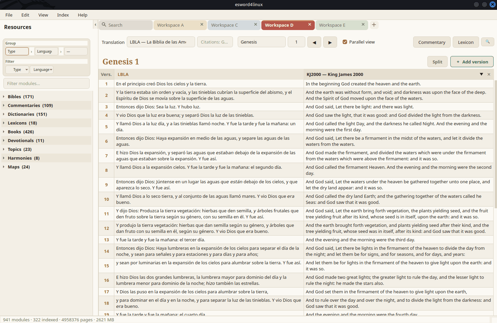
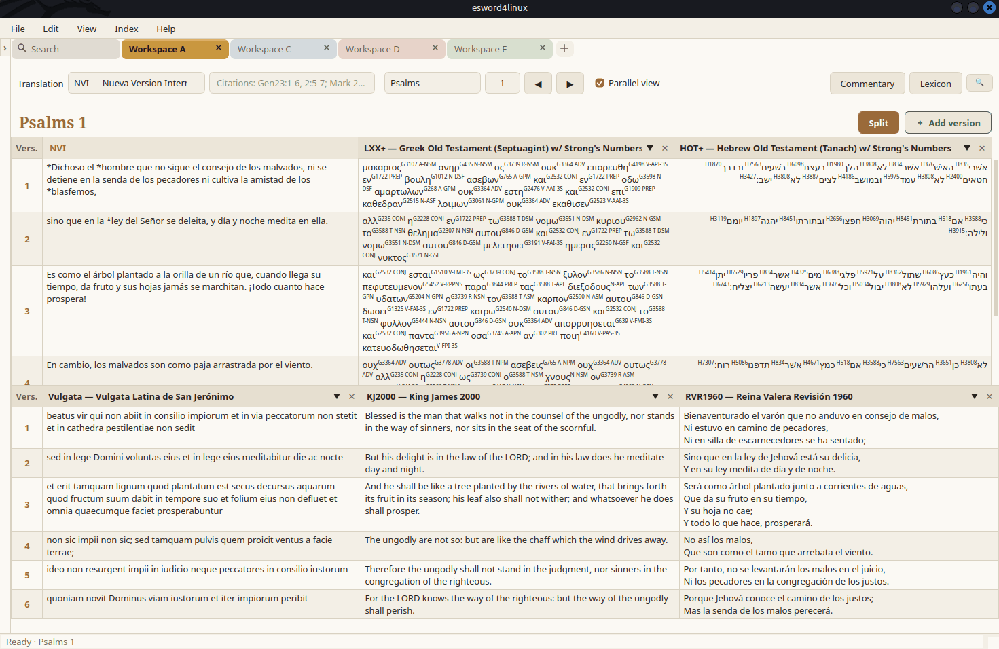
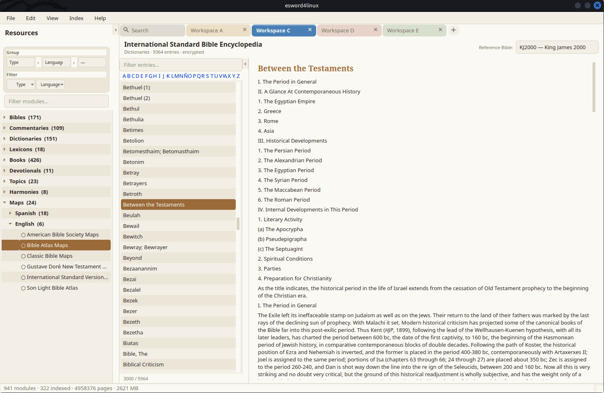

# esword4linux

**Lector nativo para Linux de módulos de e-Sword — sin Wine y sin contenido incluido.**

[English](README.md) · [Guía de instalación detallada (English)](docs/INSTALL.md) · [Documentación](docs/README.md) · [Cambios](docs/CHANGELOG.md)

<p align="center">
  
</p>

esword4linux abre los módulos SQLite que ya posees desde **una única carpeta
elegida por ti**. Clasifica cada archivo por la estructura de su base de datos,
no por la extensión, y no modifica ni un byte de tu biblioteca.

> **Este repositorio no incluye biblias, comentarios, diccionarios ni ningún
> otro módulo de e-Sword.** En el primer arranque eliges la carpeta que contiene
> tus propios módulos. Los módulos de e-Sword son propiedad de sus respectivos
> editores.



## Características

- **Una sola carpeta de módulos.** Lee cualquier módulo compatible en su sitio,
  en modo de solo lectura.
- **Detección por estructura.** Un `.refx` que en realidad es un tópico o un
  `.cmtx` con el esquema antiguo de comentarios se clasifican correctamente.
- **Pestañas-vista.** Cada pestaña tiene su recurso principal, su biblia paralela
  y su panel de comentario. Al seleccionar un módulo se reutiliza la pestaña
  activa; `Ctrl+T` crea otra.
- **Panel lateral organizable.** Agrupa por tipo, idioma y obra, combina hasta
  tres niveles y filtra por varios tipos o idiomas a la vez (`Ctrl+B` lo pliega).
- **Lectura bíblica.** Traducción paralela, navegación por capítulos, cadenas de
  citas múltiples, burbujas de versículos y de números Strong.
- **Paneles de comentario y léxico.** El comentario se empareja con la biblia
  activa y se muestra en el panel inferior; el léxico Strong usa ese mismo panel.
- **Búsqueda unificada.** Una sola caja entiende referencias bíblicas, números
  Strong y texto libre. El índice FTS5 es opcional y solo se construye cuando tú
  lo pides.
- **Cuatro modos de búsqueda.** Todas las palabras, cualquiera de las palabras,
  frase exacta o una expresión regular. La búsqueda se lanza al pulsar Intro o
  *Buscar*, nunca mientras escribes.
- **Filtros de búsqueda avanzados.** Acota cualquier búsqueda por tipo de
  material, por una obra concreta y —en las biblias— por libro y capítulo, o por
  un rango avanzado (testamento, grupo canónico, rango de libros, rango de
  capítulos). Los filtros se combinan y se mantienen coherentes: un valor exacto
  y un rango son mutuamente excluyentes.
- **Vista previa de cualquier resultado.** Las citas de los resultados son
  enlaces; al pasar el ratón se muestra el pasaje completo de la versión de la
  que procede el resultado, sin salir de la lista.
- **Áreas de herramientas adaptables.** Las barras y los filtros saltan a la
  línea siguiente en ventanas estrechas en lugar de esconder controles tras un
  desplazamiento horizontal.
- **Módulos cifrados.** Los módulos SQLitePlus/Twofish-128 se pueden leer e
  indexar.
- **Interfaz bilingüe.** Español e inglés, con cambio en caliente.
- **Tipografía legible.** Fuentes independientes para interfaz, Escritura y texto
  corriente; temas claro y oscuro.

## Capturas

<table>
  <tr>
    <td width="50%" valign="top">
      <br>
      <b>Biblia paralela.</b> Dos traducciones lado a lado, con el árbol de
      recursos, el organizador de agrupaciones y una pestaña por espacio de
      trabajo.
    </td>
    <td width="50%" valign="top">
      <br>
      <b>Tabla comparativa.</b> Seis traducciones —incluidas la Septuaginta y el
      texto hebreo— alineadas versículo a versículo en dos bandas apiladas.
    </td>
  </tr>
  <tr>
    <td width="50%" valign="top">
      <br>
      <b>Mapas.</b> Los módulos de mapas se leen en su sitio, con zoom, ajuste a
      la ventana y leyenda.
    </td>
    <td width="50%" valign="top">
      <br>
      <b>Diccionarios.</b> Índice A–Z, filtro instantáneo y una biblia de
      referencia independiente para las burbujas de los versículos de la entrada.
    </td>
  </tr>
</table>

## Requisitos

El entorno de referencia para v0.5.2 es:

- **Ubuntu 24.04 LTS (noble), amd64** — verificado instalando desde el PPA de
  Launchpad (ver *Instalación*). Lubuntu 24.04 se probó en una máquina virtual:
  el paquete se instaló con APT y varias biblias, diccionarios y comentarios
  cargaron correctamente.
- **Linux Mint 22.3** (base Ubuntu 24.04/noble), Cinnamon/X11
- **Python 3.12.3**
- Una sesión gráfica de escritorio. Esta guía se verificó en X11; el paquete de
  PySide6 incluye un plugin de Wayland, pero Wayland no se verificó.
- **Conexión a Internet la primera vez** que ejecutes `./run.sh` o
  `make install`, para descargar las dependencias de Python desde PyPI. Una vez
  creado el entorno virtual, los arranques normales funcionan sin red.

El proyecto declara Python 3.10 o superior. Otras versiones de Ubuntu, Mint o
Debian y otras arquitecturas no se verificaron para v0.5.2.

### Dependencias del sistema en Linux Mint / Ubuntu

```bash
sudo apt update
sudo apt install -y python3 python3-venv
sudo apt install -y libegl1 libgl1 libxkbcommon-x11-0 libxcb-cursor0 \
    libxcb-icccm4 libxcb-image0 libxcb-keysyms1 libxcb-randr0 \
    libxcb-render-util0 libxcb-shape0 libxcb-xkb1
```

Si instalas desde Git o usas los comandos `make`, instala también:

```bash
sudo apt install -y git make
```

Si usas los ejemplos de terminal para descargar archivos, instala también
`curl` y `unzip`:

```bash
sudo apt install -y curl unzip
```

Estas instrucciones no necesitan `python3-pip`: el entorno virtual crea su
propio `pip`. Los nombres de los paquetes Qt se verificaron en Linux Mint 22.3
contra el plugin `libqxcb.so` real de PySide6.

## Instalación

Los requisitos detallados, la solución de problemas y las notas de
desinstalación están en [`docs/INSTALL.md`](docs/INSTALL.md) (en inglés).

### Ubuntu 24.04 LTS desde el PPA de Launchpad (recomendado)

El PPA es la forma más sencilla de instalar y mantener la aplicación actualizada
en un sistema Ubuntu compatible:

```bash
sudo apt update
sudo apt install software-properties-common
sudo add-apt-repository ppa:felotrrs/esword4linux
sudo apt update
sudo apt install esword4linux
```

Página del PPA: <https://launchpad.net/~felotrrs/+archive/ubuntu/esword4linux>

- Es un **PPA público de terceros alojado en Launchpad**, no un repositorio
  oficial de Ubuntu. Ubuntu no revisa ni da soporte a sus paquetes.
- El objetivo verificado es **Ubuntu 24.04 LTS (noble) en amd64**; el paquete
  publicado es `0.5.2-3`. Lubuntu 24.04 se probó en una máquina virtual: la
  instalación con APT funcionó y varios módulos de biblia, diccionario y
  comentario cargaron correctamente.
- Otras versiones de Ubuntu, otras arquitecturas y otras distribuciones **no se
  declaran compatibles**.
- Tras la primera instalación, las actualizaciones llegan con el flujo normal de
  APT:

  ```bash
  sudo apt update
  sudo apt upgrade
  ```

  `apt` conserva `~/.config/esword4linux/` y `~/.cache/esword4linux/`.

Para desinstalarlo:

```bash
sudo apt remove esword4linux
sudo add-apt-repository --remove ppa:felotrrs/esword4linux
```

### Paquete Debian nativo (Ubuntu 24.04 / Linux Mint 22.x)

Descarga el paquete publicado e instálalo con `apt`:

```bash
curl -L -O https://ppa.launchpadcontent.net/felotrrs/esword4linux/ubuntu/pool/main/e/esword4linux/esword4linux_0.5.2-3_amd64.deb
sudo apt install ./esword4linux_0.5.2-3_amd64.deb
esword4linux
```

El paquete incluye PySide6-Essentials, shiboken6, Qt 6 y PyYAML en un entorno
privado bajo `/opt/esword4linux` e instala la entrada de escritorio, los iconos,
la página de manual y los textos de licencia. Usa el `/usr/bin/python3` de la
distribución sin modificar el Python del sistema. Construcción desde un
checkout:

```bash
packaging/build-deb.sh
```

El resultado es `dist/deb/esword4linux_<version>_amd64.deb`, donde `<version>`
es la revisión Debian de `debian/changelog`. X11 se validó en Linux Mint 22.3;
Wayland se validó con Weston 13 headless/kiosk, pero no hubo una sesión completa
de compositor de escritorio durante el empaquetado.

Para construir el paquete Debian de código fuente (por ejemplo para un PPA de
Launchpad):

```bash
make deb-src-verify
```

El `.orig.tar.xz` generado en `dist/src/` incorpora las ruedas fijadas, así que
la construcción no necesita acceso a PyPI. El resultado está orientado a un PPA:
las ruedas precompiladas no son aceptables directamente en los archivos
principales de Debian/Ubuntu.

### Desde Git

```bash
git clone https://github.com/felotrrs/esword4linux.git
cd esword4linux
./run.sh
```

El primer `./run.sh` crea `.venv`, instala PySide6-Essentials y PyYAML desde
PyPI y abre la aplicación. Este primer paso necesita Internet. Los arranques
posteriores usan el entorno ya creado y funcionan sin red.

Para desarrollo, `make install` crea el mismo entorno virtual e instala además
el extra `dev` (`pytest`):

```bash
make install
make run
```

### Desde un archivo ZIP/TAR de código fuente

Descarga el código fuente de v0.5.2 desde GitHub:

- [esword4linux v0.5.2 tar.gz](https://github.com/felotrrs/esword4linux/archive/refs/tags/v0.5.2.tar.gz)
- [esword4linux v0.5.2 zip](https://github.com/felotrrs/esword4linux/archive/refs/tags/v0.5.2.zip)

Extráelo con tu gestor de archivos o desde una terminal:

```bash
curl -L -o esword4linux-v0.5.2.tar.gz \
  https://github.com/felotrrs/esword4linux/archive/refs/tags/v0.5.2.tar.gz
tar -xzf esword4linux-v0.5.2.tar.gz
cd esword4linux-0.5.2
./run.sh
```

Para el ZIP, sustituye la descarga y la extracción por
`curl -L -o esword4linux-v0.5.2.zip ...` y `unzip esword4linux-v0.5.2.zip`.
Los ejemplos de terminal usan `curl`, `tar` y `unzip`; también puedes usar el
gestor de archivos.

### Primer arranque

En el primer inicio, esword4linux pide la carpeta que contiene tus módulos de
e-Sword (`.bblx`, `.bbli`, `.cmtx`, `.cmti`, `.dctx`, `.lexi`, `.refx`, `.topx`,
`.devx`, `.harx`, `.mapx`, `.twm`…). Si cancelas, la aplicación se cierra.
Puedes cambiar la carpeta después desde **Archivo → Cambiar carpeta de módulos**.

## Lanzamiento

Desde el checkout:

```bash
./run.sh
```

O, después de `make install`:

```bash
make run
```

### Lanzador de escritorio

Después de que `./run.sh` o `make install` hayan creado el entorno virtual,
ejecuta:

```bash
make desktop
```

Esto instala `~/.local/share/applications/esword4linux.desktop` y los iconos de
la aplicación en `~/.local/share/icons/hicolor/`. El lanzador usa el script
`run.sh` de la **ubicación actual del checkout**; si mueves o borras el
checkout, la entrada del menú deja de funcionar. Ejecuta `make desktop` de nuevo
desde la nueva ubicación para repararla.

La entrada del menú puede tardar un momento en aparecer, o puede requerir cerrar
y volver a iniciar sesión.

## Desinstalación

### Instalado desde el PPA o desde un `.deb`

```bash
sudo apt remove esword4linux
sudo add-apt-repository --remove ppa:felotrrs/esword4linux   # solo el PPA
```

La desinstalación borra solo los archivos del paquete. Tus preferencias y cachés
se **conservan** (ver abajo).

### Ejecutando desde un checkout

Un checkout de código fuente no tiene instalador para todo el sistema ni un
objetivo `make uninstall`.

1. Borra la carpeta del checkout (por ejemplo `esword4linux` o
   `esword4linux-0.5.2`).
2. Si ejecutaste `make desktop`, elimina el lanzador y los iconos:

   ```bash
   rm -f ~/.local/share/applications/esword4linux.desktop
   rm -f ~/.local/share/icons/hicolor/*/apps/esword4linux.png
   gtk-update-icon-cache -f -t ~/.local/share/icons/hicolor 2>/dev/null || true
   update-desktop-database ~/.local/share/applications 2>/dev/null || true
   ```

Tus preferencias y la caché de búsqueda se **conservan** por defecto:

- `~/.config/esword4linux/` (preferencias)
- `~/.cache/esword4linux/` (catálogo e índice de búsqueda)

Elimínalos manualmente solo si quieres una desinstalación completamente limpia:

```bash
rm -rf ~/.config/esword4linux ~/.cache/esword4linux
```

esword4linux nunca modifica tu carpeta de módulos de e-Sword. Bórrala solo si
quieres eliminar tus propios módulos.

`make clean` elimina únicamente `.venv`, `.pytest_cache` y el `.cache` del
repositorio; **no** elimina la configuración/caché XDG ni el lanzador y los
iconos del escritorio.

## Leer no es indexar

La lectura es directa y no necesita índice. El primer escaneo solo recoge
metadatos para que el panel lateral muestre tu biblioteca.

Genera los índices de búsqueda solo cuando quieras:

- **Índice → Indexar esta categoría** para un tipo de módulo
- **Índice → Indexar todo** para toda la biblioteca
- **Índice → Descifrar módulos cifrados** para módulos SQLitePlus
- o desde la línea de comandos:

```bash
make scan          # solo metadatos
make encrypted     # descifra e indexa módulos cifrados (explícito)
python tools/bootstrap.py --kind bible
python tools/bootstrap.py --all
```

Ningún módulo se indexa ni se descifra automáticamente al arrancar.

## Estado de distribución

**v0.5.2** se distribuye como código Git, como los archivos fuente que genera
GitHub desde el tag, como paquete Debian nativo para Ubuntu 24.04 / Linux Mint
22.x (amd64) y a través del PPA público de Launchpad
[`ppa:felotrrs/esword4linux`](https://launchpad.net/~felotrrs/+archive/ubuntu/esword4linux)
(`0.5.2-3`, noble/amd64). Todavía no se proporciona AppImage, Flatpak ni Snap.
Consulta [`docs/INSTALL.md`](docs/INSTALL.md#distribution-status-and-validation-matrix)
para ver qué se validó realmente.

## Ubicación de los datos

| Qué | Dónde |
|---|---|
| Módulos | Tu propia carpeta, en solo lectura |
| Preferencias | `~/.config/esword4linux/settings.json` |
| Catálogo | `~/.cache/esword4linux/catalog.db` |
| Índice de búsqueda | `~/.cache/esword4linux/content.db` |

El catálogo y el índice son regenerables. Borrar la caché es seguro; tus módulos
no se tocan.

## Familias de módulos compatibles

| Familia | Extensiones típicas | Detección |
|---|---|---|
| Biblias | `.bblx`, `.bbli` | tabla `Bible` |
| Comentarios | `.cmtx`, `.cmti` | `Verses`, `VerseCommentary`, `BookCommentary` o `ChapterCommentary` |
| Diccionarios | `.dctx`, `.dcti`, `.twm` | `Dictionary`, o `topics` + `config` |
| Léxicos | `.lexi`, `.lexx` | `Lexicon` |
| Libros / referencias | `.refx`, `.refi`, `.topx` | `Reference` o `Topics`, refinado por contenido |
| Devocionales | `.devx` | `Devotions` o `Devotional` |
| Armonías | `.harx` | `Sections` + `Parts` |
| Mapas | `.mapx` | `Graphics` |

La extensión solo sirve para descubrir archivos. El tipo siempre sale de la
estructura SQL.

## Desarrollo

```bash
make install
make test
```

La suite se ejecuta sin ningún módulo de e-Sword. Las pruebas que necesitan
módulos reales se omiten salvo que indiques un corpus:

```bash
ESWORD4LINUX_TEST_CORPUS=/ruta/a/tus/modulos .venv/bin/python -m pytest -q
```

Nunca hagas commit de módulos. `.gitignore` bloquea a propósito las extensiones
habituales de e-Sword.

Consulta [AGENTS.md](AGENTS.md) para las reglas del proyecto,
[CONTRIBUTING.md](CONTRIBUTING.md) para el flujo de desarrollo y [docs/](docs/)
para arquitectura, notas de formato, deuda técnica y ADRs.

## Licencia

**GPL-3.0**. El descifrador Twofish es un port de
[KingJamesPureBibleSearch](https://github.com/dewhisna/KingJamesPureBibleSearch)
(© Donna Whisnant, GPL-3.0). Ver [LICENSE](LICENSE) y
[THIRD_PARTY_NOTICES.md](THIRD_PARTY_NOTICES.md).

Los módulos de e-Sword son propiedad de sus respectivos titulares. esword4linux
es solo un lector: no distribuye ni modifica su contenido.
